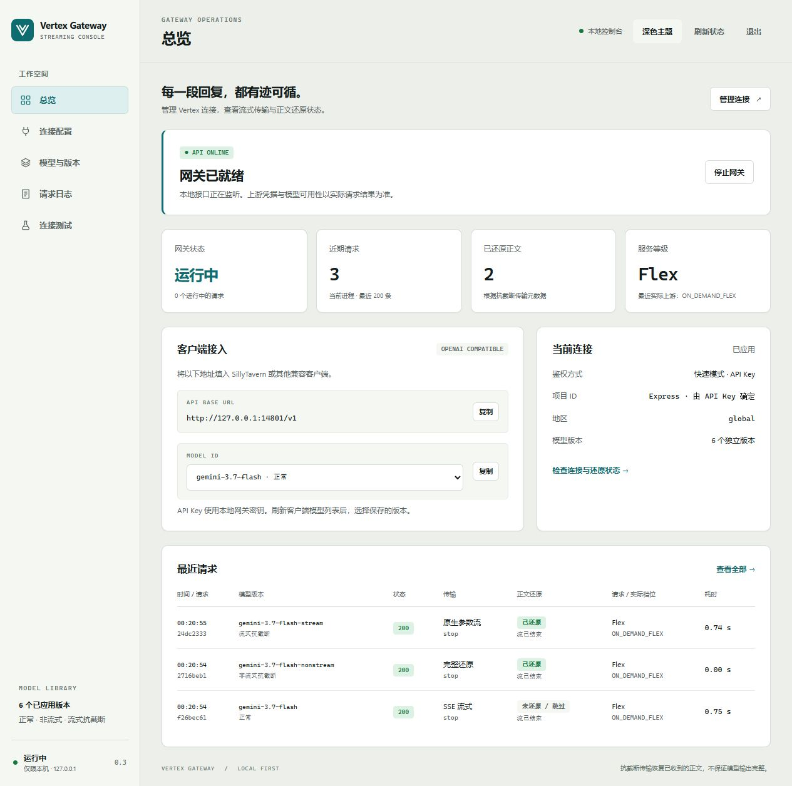
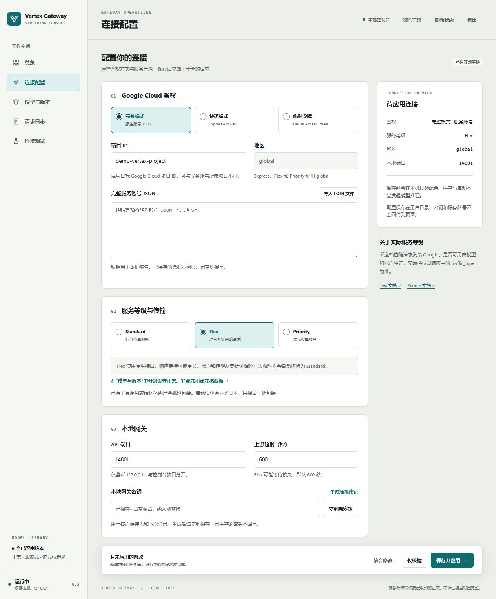
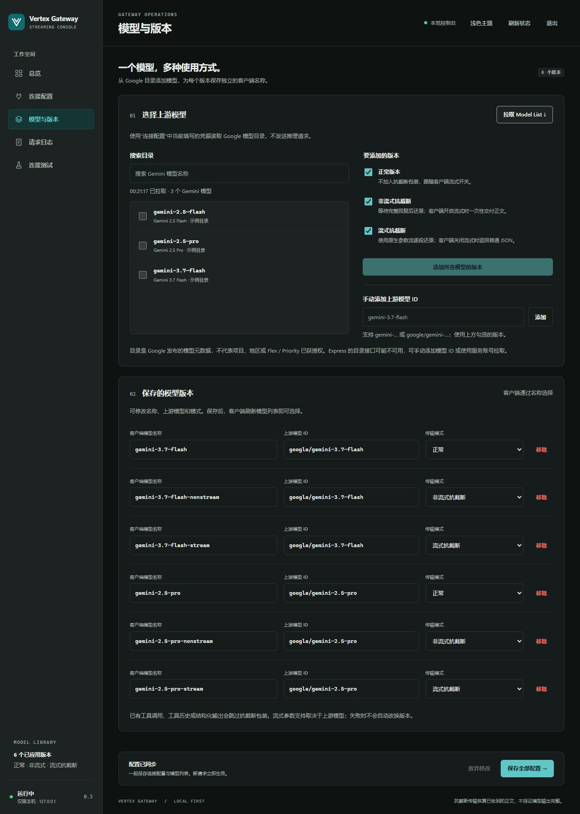
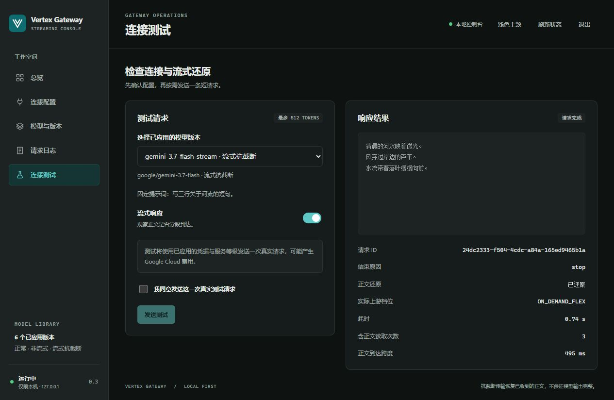

# Standalone gateway guide

[中文](GATEWAY.md) | English · [Project home](../README.en.md)

The gateway exposes `/v1/models` and `/v1/chat/completions` to OpenAI-compatible clients. Each saved model profile selects an upstream model and a transport mode. The default profile uses Gemini 3.7 Flash.

[Setup](#setup) · [Model profiles](#model-library-and-variants) · [Custom upstream](#custom-upstream) · [Tag stop](#custom-tag-stop) · [Request logs](#checking-a-request)

## Setup

For Docker, pull `ghcr.io/ken050210/vertex-streaming-anti-truncation:latest`. Download the Compose file, run `docker compose pull` and `docker compose up -d`, then use `docker compose logs vertex-gateway` for the first-time setup link. The image includes the console and API, with settings in a persistent volume. See [Docker deployment](DOCKER.en.md) for downloads, ports, remote servers, reverse proxies and Dockerized Tavern. The instructions below run directly on Node.js.

Choose a full Vertex service-account JSON, an Express mode API key, or a short-lived OAuth access token, or connect an OpenAI-compatible service that serves Gemini models instead (see [Custom upstream](#custom-upstream)). Full mode requires a Google Cloud project with the Vertex AI API enabled and permission to call the model. Inference is billed to your Google Cloud account.

```sh
git clone https://github.com/ken050210/vertex-streaming-anti-truncation.git
cd vertex-streaming-anti-truncation
npm ci --ignore-scripts
npm start
```

Open the console link printed in the terminal (default `http://127.0.0.1:4780/`). On first launch, use the setup link containing a local bootstrap key. On Windows you can also double-click `Start-GUI.cmd`. No `.env` is required for GUI setup.

### Connection and access

Import the complete service-account JSON or choose Express, OAuth or a [custom upstream](#custom-upstream). The console fills the project ID from the service account. You can change it to another project that account can access. Express keys, access tokens and relay keys accept visible ASCII characters. Smart quotes and full-width characters cause a validation error on save.

Select Standard, Flex or Priority. Express and the two non-standard tiers require `global`. In Express mode, enter the key's project ID or number to use `projects/{project}/locations/global`. Leaving the project blank lets Express choose the location. Gemini 4 Argon and Carbon require the project and return `express_project_required` locally if it is missing.

The local access mode applies to both the client API and the console.

| Mode | What the client uses |
| --- | --- |
| Strict (default) | A key of 16 to 512 visible ASCII characters without spaces |
| Weak | A key of 1 to 512 visible ASCII characters, for example `123456` |
| Keyless | An empty API key or any placeholder the client requires |

Copy a generated key before saving. Saved credentials do not appear in the form again. A blank field keeps the existing value. After the first save, if another authentication mode still has a stored credential, you can select “保存时删除其他鉴权方式已保存的凭据” to delete it on save. Changing the authentication mode clears that checkbox.

Switching to weak or keyless access requires confirmation in the console. Keyless mode clears the stored gateway key. Anyone who can reach the service can run models, read logs and edit settings. Changing the gateway key or access mode signs out other sessions. Enter a new key to switch back from keyless mode.

### Models, tests and saved settings

Under **模型与版本**, search the model catalog or enter an upstream ID, then save a client-facing name and transport mode for each profile. You can keep up to 100 profiles. The overview shows the client URL and lets you start or stop the gateway. Its 200 most recent request records include the finish reason, restoration status, requested and actual tiers, token usage and [estimated cost](#usage-and-cost-estimates). The console supports narrow screens and light and dark themes.

The test page sends a request only when you select a saved model, confirm and run the test. It supports buffered or streaming replies, cancellation and timing statistics, with a limit of 512 output tokens. Startup, saving, validation and catalog discovery do not run inference.

Settings and credentials are stored as plaintext in `~/.vertex-streaming-anti-truncation/settings.json`, outside the repository and browser storage. Use `GATEWAY_STATE_DIR` to select another private directory. The console port defaults to `4780` (`GUI_PORT`) and the API port to `4781`. Restarting the console loads the saved settings and starts the gateway. Saving checks the settings revision and replaces the file atomically. New requests use the new settings, and in-flight replies keep their existing settings. A port conflict leaves the prior configuration and listener active. A client still using an old API connection after a port change receives `503 gateway_port_changed`.

Before the first save, system and shell variables take precedence over `.env`, including empty entries in `.env` (confirmed with Node.js 24.16 and `--env-file`). For example, `GOOGLE_APPLICATION_CREDENTIALS` preloads the service account it points to and the form shows 已从环境变量导入. To use another account, choose a different method before saving, or remove the variable and restart. The first save stores only the selected method's credentials. If any initial setting is invalid, such as an unreadable file or conflicting methods, the console opens with the cause and skips the entire environment configuration. Saved GUI settings take precedence on later starts.

A stale `settings.lock.recovery` file after an interrupted lock recovery can make every save report another editor. Stop the console and any other settings writers, back up `settings.json`, then remove only `settings.lock.recovery` from that directory and restart.

A saved non-ASCII gateway key, Express key or access token from an older configuration prevents the API from starting. Sign in to the console with the old key and replace the affected value with visible ASCII. For CLI-only use, update `.env` or the environment variable that supplies it.

### CLI-only setup

Copy `.env.example` to `.env`: use `Copy-Item .env.example .env` in Windows PowerShell or `cp .env.example .env` on Linux/macOS. Set:

- `GATEWAY_KEY_MODE`: defaults to `strict`. Explicitly setting `weak` accepts simple keys; setting `none` accepts keyless access to both API and console, including the ability to call models and manage settings.
- `GATEWAY_API_KEY`: 16–512 visible ASCII characters without spaces in `strict` mode; 1–512 characters (e.g. `123456`) in `weak` mode; ignored in `none` mode.
- `VERTEX_PROJECT_ID`: your Google Cloud project ID. `VERTEX_LOCATION` defaults to `global`.
- `GOOGLE_APPLICATION_CREDENTIALS`: this line is commented out in `.env.example`. For a service account, remove the leading `#` and set the path to a service-account JSON file outside the repository. On Windows, `C:/keys/service-account.json` works.
- Alternatively keep that line commented and set `VERTEX_ACCESS_TOKEN`, or use `VERTEX_API_KEY` for Express mode (no project required), or `CUSTOM_UPSTREAM_URL` and `CUSTOM_UPSTREAM_API_KEY` for a [custom upstream](#custom-upstream) (no project required). Choose exactly one; with none set, `npm run gateway` prints `Configure one upstream authentication method: …` and exits.
- `VERTEX_SERVICE_TIER`: `standard` (default), `flex` or `priority`. Set `ANTI_TRUNCATION=false` to disable wrapping.
- `PORT`: defaults to `4781`.

Variables already set in the system or shell take precedence over `.env`. Generate a gateway key with this command, save it in `.env`, then start the service:

```sh
node -e "console.log(require('node:crypto').randomBytes(32).toString('hex'))"
npm run gateway
```

Native installs bind to `127.0.0.1` by default. Docker listens on `0.0.0.0` inside the container and publishes ports only on host loopback by default. `GET /healthz` checks the process; every other API endpoint requires `Authorization: Bearer <GATEWAY_API_KEY>` in strict/weak mode. Keyless mode skips that check, including for logs. The console retains sessions, Host/Origin and CSRF checks; those checks do not replace the identity verification disabled by keyless mode. The service-account private key signs a JWT inside the gateway process. That JWT is sent to Google OAuth to obtain the short-lived access token used for model requests.

### Using a proxy for Google

The gateway reaches Google through Node's built-in fetch, which ignores proxy variables by default. To use a proxy:

- Set `NODE_USE_ENV_PROXY=1` in the system, user or shell environment **before Node starts**. Putting it in `.env` has no effect (tested on Node.js 24.16). If you start by double-clicking `Start-GUI.cmd`, set it as a Windows user environment variable.
- Set `HTTPS_PROXY` to your proxy, and preferably `NO_PROXY=127.0.0.1,localhost` so local connections, such as the console's connection test to the local gateway, bypass it. These two can be in the environment or in `.env`.
- This needs Node.js 22.21.0+ on the 22.x line, or 24.0.0+. Earlier 22.x releases ignore `NODE_USE_ENV_PROXY` and connect to Google directly.

```powershell
$env:NODE_USE_ENV_PROXY = "1"; $env:HTTPS_PROXY = "http://127.0.0.1:7890"; $env:NO_PROXY = "127.0.0.1,localhost"; npm start
```

```sh
NODE_USE_ENV_PROXY=1 HTTPS_PROXY=http://127.0.0.1:7890 NO_PROXY=127.0.0.1,localhost npm start
```

Replace `http://127.0.0.1:7890` with your proxy. `UPSTREAM_TIMEOUT_MS` also applies through the proxy; when the upstream cannot be reached, the log records `502 upstream_unreachable`. These settings apply to a [custom upstream](#custom-upstream) too; add a relay on your local network to `NO_PROXY`, or its requests will go through the proxy. The proxy path has local tests only and no live verification yet.

## Model library and variants

Direct Vertex requests for `gemini-4-carbon` always use `global`. The default model list includes normal, buffered and streaming anti-truncation profiles. With an existing model list, check the variants you want, click **添加 Gemini 4 Carbon（global）**, save, then refresh the model list in your client.

Enter credentials under **连接配置**, then open **模型与版本** and click **拉取 Model List**. Discovery uses the current connection form plus saved credentials, without starting inference or saving the draft. Search and select multiple models, check the variants to add, then click **保存全部配置** to save both connection and model drafts. Refresh the model list in your client afterwards.

| Variant | Behavior | Generated alias |
| --- | --- | --- |
| Normal | No wrapper; follows the client's `stream` setting | `<model>` |
| Buffered anti-truncation | Restores a complete upstream response; delivers it at once as SSE if requested | `<model>-antitruncation-nonstream` |
| Streaming anti-truncation | Native argument streaming for SSE; ordinary restored JSON otherwise | `<model>-antitruncation-stream` |

Save up to 100 profiles with unique public names, including Chinese aliases. Each row can change its upstream ID and mode. `/v1/models` exposes saved profiles. The add action skips existing upstream/mode pairs; manual edits may retain multiple aliases for the same pair. Saving an empty list exposes no models. Existing `gemini-3.7-flash-antitruncation` settings retain their name and previous enabled/disabled behavior on upgrade; explicit profiles replace the legacy global switch.

Discovery uses Google's paginated [publisher model catalog](https://docs.cloud.google.com/gemini-enterprise-agent-platform/reference/rest/v1beta1/publishers.models/list) and filters Gemini IDs. Catalog presence does not establish project access, region, modality or tier support. The [Express API reference](https://docs.cloud.google.com/gemini-enterprise-agent-platform/reference/express-mode/api-reference) does not guarantee listing support: if an API key cannot list models, use a service account for discovery or manually enter `gemini-…`, `google/gemini-…` or `publishers/google/models/gemini-…`. Errors preserve existing profiles and do not return a fabricated fallback catalog.

## Custom upstream

Besides Google's Vertex endpoints, the gateway can use an **OpenAI-compatible service that serves Gemini models**: a relay, a new-api / one-api style service, or Google AI Studio's OpenAI-compatible endpoint. Under **连接配置**, choose **自定义上游** (custom upstream) and fill in:

- **Base URL**, up to the `/v1` level, for example `https://relay.example.com/v1`. Requests go to `<base>/chat/completions`; discovery reads `<base>/models`. A pasted `…/chat/completions` endpoint is accepted too. `http://` (local or LAN services) and `https://` both work; the URL cannot contain credentials, `?` or `#`.
- **Upstream API key**, sent as `Authorization: Bearer <key>`. It must be visible ASCII and is write-only once saved.

Add models under **模型与版本** as usual. Relays name models in different ways, such as `gemini-2.5-pro`, `google/gemini-2.5-pro` or `[满血]Gemini-2.5-Pro`, so with a custom upstream **the upstream model name is sent exactly as shown**; the gateway neither adds nor strips a prefix:

- Discovery reads the upstream's model list and shows the names that contain `gemini` (any case), exactly as listed. Picking from it guarantees a name the upstream knows.
- Manual entry accepts capitals, brackets, Chinese and prefixes; a name only has to be non-empty, free of control characters such as line breaks, and at most 200 characters. The client-facing name drops disallowed characters, so `[满血]Gemini-2.5-Pro` becomes `满血-Gemini-2.5-Pro`, which you can rename.
- After a save, the console reads the upstream's model list again (listing only, no inference charge) and lists names that are missing from it, with a similar listed name when there is one, for example `google/gemini-3.7-flash`（列表里有：`gemini-3.7-flash`）. It warns without blocking, since some relays list only part of their models, and says so when the list cannot be read.
- The gateway recognizes which Gemini model a name refers to (for example `gemini-4-argon` in `[满血]Gemini-4-Argon`) for model-specific handling such as Gemini 4 thinking levels and prefill conversion. This never changes the name that is sent; when no model is recognizable, that handling is skipped and the request goes out as usual.

Switching from Vertex to a custom upstream keeps the existing `google/gemini-…` names, which are then sent as they are; if the relay does not know them, the post-save check says so and you can rename them. Switching back to Vertex requires replacing names that do not follow Vertex's format before saving.

How it differs from Vertex:

| Item | Custom upstream |
| --- | --- |
| Service tier, location, project ID | Not used; billing and model availability are up to the upstream |
| Normal profiles | Forwarded as-is |
| Buffered anti-truncation | Works if the upstream supports OpenAI tool calling and honors a forced `tool_choice` |
| Streaming anti-truncation | Works over the compatible stream, not Vertex's native argument stream. Whether text appears progressively depends on whether the upstream forwards tool arguments in pieces; otherwise the text arrives at once when the upstream finishes. The request log shows the transport as `tool-transport-buffered-fields` |
| Gemini-specific fields such as thinking levels | Sent as-is (for example `extra_body.google`); whether they take effect is up to the upstream |
| [Cost estimates](#usage-and-cost-estimates) | None; the log records token counts when the upstream reports usage |

Without tool-calling support upstream, anti-truncation cannot work: the upstream may reject the request, or ignore the tool and reply with plain text (the log shows the text as not restored). Use a normal profile in that case. The SillyTavern plugin (Vertex connection panel) does not use this setting.

## Account rotation (standalone gateway)

Off by default. In Connection settings, add accounts under 多账号轮询, enable the toggle and save. The existing connection is the primary account; up to 19 additional accounts participate in round robin per request. Vertex service accounts, Express keys and OAuth tokens can mix. Custom upstreams can only share a pool with other custom upstreams. All accounts share models and the selected tier and must have access to those models. Model discovery still uses the primary connection.

The per-account timeout defaults to 60 seconds (1–1800), covering authentication and the entire response. The consecutive failure threshold defaults to 2 (1–100); success resets it. Authentication, timeout, network/protocol failures and HTTP 401/403/408/429/5xx count. Invalid client input, exhausted prompt-specific recovery, client cancellation and the overall request deadline do not count. At the threshold the account is skipped for the cooldown, default 60 seconds (1–3600), then becomes eligible again without background inference probes.

At the threshold, a request with no output yet can switch to the next eligible account. Each account is attempted at most once per request. Below the threshold the error is returned. Once streaming output starts, failure closes the stream without replay. If every account is cooling down, requests return `503 accounts_unavailable`. An account timeout is `504 account_timeout`; the existing `UPSTREAM_TIMEOUT_MS` still bounds the entire request, and no switch occurs after that budget expires. Retries can incur additional usage. Prompt recovery and long decode stay within an account attempt.

Saving or restarting resets rotation and failure state; in-flight requests retain their snapshot. Disabling rotation uses only the primary account. Additional secrets are stored in the existing settings file, never returned to the page: blank preserves, replacement text updates, removing and saving deletes the entry. Logs include account IDs, statuses and durations in `accountAttempts`, without credentials. Usage estimates reflect only the final attempt's reported usage, excluding possible charges for failed attempts.

For CLI use, set `ACCOUNT_ROTATION_ENABLED=true`, `ACCOUNT_TIMEOUT_MS=60000`, `ACCOUNT_FAILURE_THRESHOLD=2`, `ACCOUNT_COOLDOWN_MS=60000` and `GATEWAY_ACCOUNTS_FILE` in `.env`. Existing variables still configure the primary account. The accounts file is a private JSON array outside the repository. Each entry has a unique `id` (not `primary`), `name`, `authMode`, `credential`, and Vertex `projectId` / `location` (defaults to `global`) or custom `customBaseUrl`. A service-account credential is the full JSON encoded as a string; other modes use their key or token. Never commit the file.

## SillyTavern

Under Chat Completion, select the custom OpenAI-compatible connection:

| Setting | Value |
| --- | --- |
| API URL | `http://127.0.0.1:4781/v1` |
| API Key | The local gateway key from GUI setup or `GATEWAY_API_KEY` from `.env`; leave blank in keyless mode, or use any placeholder if required by the client |
| Model | A saved alias from the refreshed list; default `gemini-3.7-flash-antitruncation` |
| Streaming | Optional; buffered anti-truncation waits for the complete response |

If your preset already uses a similar text-tool transport script, keep only one wrapper enabled.

The gateway accepts the Anthropic-style field `thinking: {type: "disabled"}` as a no-op, matching Vertex's compatible endpoint. It does not disable Gemini thinking. Use `extra_body.google.thinking_config` for Gemini thinking settings.

## Custom tag stop

In the console, open Connection settings and find 自定义标签截停 (custom tag stop). The default rule ends an anti-truncation reply at the second complete `<tucao>…</tucao>` pair. Enter `A` and `1` to keep the first complete `<A>…</A>` pair and end the reply there. The closing tag stays in the text. Any later content, including an MVU update, is discarded.

The matcher reads the current reply's visible text, including tags split across chunks. Names are case-sensitive and tags must have no attributes. A stray closing tag contributes zero pairs. When tags of the same name nest, only the outer pair counts. Each request starts at zero, including Continue. History, native thoughts and client tool arguments are excluded. Normal profiles and bypassed requests use their ordinary finish conditions.

With a streaming upstream the gateway cancels the reader when the rule matches. With a non-streaming upstream it clips the completed response. A local stop supplies no final token count. Upstream charges already incurred still apply.

For CLI use, set `TAG_STOP=true`, `STOP_TAG=tucao` and `STOP_COUNT=2`, or turn it off with `TAG_STOP=false`. The legacy `TUCAO_STOP` toggle still works. An explicitly saved opt-out stays off.

## Roleplay compatibility settings

Use **Connection → SillyTavern compatibility and retry** to control each feature. Existing settings receive the same defaults on upgrade.

| Feature | Default | Behavior |
| --- | --- | --- |
| Hide models without an available route | On | Filter disabled profiles and known authentication failures from `/v1/models`; temporary errors remain visible |
| Gemini 3.7 / 3.8 Flash prefill to USER | On | Change the last plain-text `assistant` message to `user` before wrapping, preserving its text |
| Prompt submission retry | Off | Enter your own text first; errors matching a rule (one by default) can add one submission |
| Gemini 4 Argon long decode | Off | Off: an output limit above one request's maximum (65,536 streamed, 32,768 unary) is sent as that maximum instead of failing. On: a reply that reaches it continues with Google's long decode. See [Gemini 4 output limits and long decode](GEMINI4.en.md#output-limits-and-long-decode) for behavior and compatibility risks |

The standalone gateway shares one upstream connection. Disable a saved profile with its Enable checkbox without deleting it. Disabled profiles cannot be called, even when the visibility filter is off. An upstream HTTP 401 hides profiles on the rejected connection until settings are reapplied, the gateway restarts, or a direct request succeeds. HTTP 403/404/429, timeouts and 5xx do not hide profiles. Listing models never probes inference and does not establish Google project access.

Google's [3.7 Flash](https://docs.cloud.google.com/gemini-enterprise-agent-platform/models/guides/gemini-3-7-flash#mandatory-api-rules-and-behavioral-conventions) and [3.8 Flash](https://docs.cloud.google.com/gemini-enterprise-agent-platform/models/guides/gemini-3-8-flash#mandatory-api-rules-and-behavioral-conventions) guides disallow histories ending in a `model` turn and require removing prefills. Converting the role to USER is this project's workaround to retain the text; it changes the message semantics and does not guarantee prefix continuation. Only nonempty plain text or text-only arrays are converted. Tool, reasoning and other extra message metadata remain untouched.

Retry rules are editable in the console under "upstream errors that trigger the retry" (one per line). When empty, the only rule is `The prompt could not be submitted`. Each rule is plain text matched case-insensitively as a substring; up to 32 rules of at most 500 characters. Only provider rejection fields are checked: `error.message` or string `error` (failed HTTP responses and SSE `event: error` also accept a top-level `message` or plain text), OpenAI-compatible `refusal` (Vertex's compatible stream places "The prompt could not be submitted. The prompt contains sensitive words…" in `delta.refusal`), and native prompt blocks from `promptFeedback.blockReason` / `blockReasonMessage` (Express, Flex and native streaming use the native API; add a reason code such as `PROHIBITED_CONTENT` if needed). HTTP errors, HTTP-200 error envelopes, refusals and initial SSE errors are inspected with a 64 KiB prefix limit. Quoted normal output does not match, and inspection stops on the first substantive text, reasoning, tool or other event. A provider error body that stalls is given up after about 5 seconds: the bytes received so far are checked against the rules, and the provider status is returned.

Supply around 7000 tokens of your own text. The GUI estimate is approximate, not Google's token count. Text is limited to 192000 UTF-8 bytes and inserted unchanged after leading `system` / `developer` messages, before the remaining conversation. It is not padded, repeated or truncated. Each client request can add at most one submission using the same model, credentials and tier. Cancellation, oversized requests and output already in progress prevent replay. A second failure ends the request. Added input can increase cost, context use and latency; successful submission is not guaranteed.

Logs add only `geminiCompatibility.prefillConverted` / `promptRetried` booleans and the console displays these outcomes; custom text is never logged. Response headers are `x-gemini-prefill-converted` / `x-gemini-prompt-retried`. CLI settings use `HIDE_UNAVAILABLE_MODELS`, `GEMINI_PREFILL_TO_USER`, `GEMINI_LONG_DECODE`, `GEMINI_PROMPT_RETRY_ENABLED`, `GEMINI_PROMPT_RETRY_TEXT_FILE` pointing to an external UTF-8 file, and `GEMINI_PROMPT_RETRY_MATCHES` with rules separated by `|`.

## Unicode input

Choose a scope in the console's Unicode input selector, then save and apply. CLI users can set `UNICODE_INPUT`.

| Value | What gets encoded |
| --- | --- |
| `false` | Off (default) |
| `true` | Text matching the current user input supplied by the client |
| `all` | System, developer, user and assistant message text, including the current input. No floor field is needed |

Current-input mode reads the latest user message from the client field below. A missing or invalid value returns `400 unicode_floor_required`. The gateway matches the original, trimmed and newline-normalized forms, preferring the longest at each position. The matcher skips replacements it has already made, existing encoded blocks and text inside complete single-line tags such as `<剧情>`. A stray `<` such as `<3` leaves later text eligible. If nothing matches, the original text is forwarded.

```json
{"router_unicode_input":{"user_floor":"latest user message"}}
```

Both scopes write Han characters and ASCII letters as `⟦U:…⟧`. Tags, existing encoded blocks, digits, punctuation and emoji keep their original form. Letters inside `{{user}}` are encoded. Model IDs, tool arguments, schemas and media URLs keep their original values. Full-context mode also skips separate tool results. Input encoding still applies when a tool or schema request bypasses output restoration. The encoding and floor-matching rules follow an encoder by 灰鸠「GoldRush」 and are included with the author's permission. [Attribution](../NOTICE.md)

The gateway strips `router_unicode_input` before forwarding the request. An encoded body above the size limit returns `413 unicode_input_too_large`. The `x-unicode-input` header gives the outcome. Logs record the encoding status and counts. Encoding can increase token use and latency. The live short-prompt checks covered current-input mode. [Acceptance record](UNICODE-INPUT-AUDIT.md)

For a Tavern custom API connection in current-input mode, enable the floor bridge. It preserves the existing custom request body using Tavern's `/lib.js` YAML parser and defaults to loopback port 4781. Edit `gatewayPort` if you use another port. Full-context mode reads the request directly. For Tavern's native Vertex connection, choose the scope in the extension panel. [Floor bridge](../integrations/sillytavern-unicode-floor.json) · [Bridge source](../integrations/sillytavern-unicode-floor.js) · [Tavern extension (Chinese)](SILLYTAVERN.md)

## Text-to-image input

Use the console selector or set `IMAGE_INPUT` to `off` (default), `current-turn` or `all`. Select either Unicode or image input. Current-turn converts eligible text after the last assistant message. If there is none, as can happen with Continue or an assistant prefill, the gateway sends the turn as text. All mode converts ordinary user and assistant text and keeps system and developer instructions, tool messages and original media. With prefill-to-USER enabled, a trailing Gemini 3.7/3.8 Flash text prefill becomes a user turn before rendering in all mode.

The renderer produces lossless WebP pages 1024 pixels wide, with up to 36 lines per page. It expands tabs to four spaces and normalizes line endings. Each text part of a user or assistant message takes at least one page. The limits are 100 pages and 150,000 UTF-16 units per request. Long chats with more than about 100 text messages generally need current-turn mode.

The base64 images and the rest of the request must fit within 8 MiB. With about 6 MiB available for images, examples ranged from 24,000 to 45,000 Chinese characters (about 20 to 28 pages), about 80,000 English characters with paragraph breaks (about 36 pages), or unbroken English up to the 150,000-unit limit (about 41 pages). The rest of the prompt and the line breaks affect how much fits.

| Failure | Result |
| --- | --- |
| Size or page limit exceeded | `413 image_input_too_large` |
| Control characters, malformed sequences or missing glyphs | HTTP 400. Bundled fonts render ❤, ❤️, 🙂, skin tones, flags and common emoji sequences |
| Missing renderer or font | `503 image_renderer_unavailable` |
| Rendering or encoding failure | `503 image_render_failed` |

A conversion error stops the request. Image input can introduce OCR errors. Replies can still stream over the native Vertex argument stream. With a custom upstream, delivery depends on the relay. Logs record only fixed metadata.

After installing or updating, run `npm ci --ignore-scripts`. An offline distribution needs the platform binary for `@napi-rs/canvas` and the bundled OFL-licensed Noto CJK font in `assets/fonts`. [Image input validation](IMAGE-INPUT-VALIDATION.md)

## How streaming works

The Antigravity gateway parses SSE events as they arrive. A relay can still buffer a tool's arguments until the call finishes. For supported requests, this gateway reads Vertex's native argument fragments and sends each decoded piece of text to the client.

| Project | Path and focus |
| --- | --- |
| Antigravity Gateway | A general OpenAI-compatible gateway with synthetic text-tool transport and incremental SSE parsing |
| This project | Calls native `streamGenerateContent`, enables `streamFunctionCallArguments`, and converts received `partialArgs` into ordinary `delta.content` |

The HTTP test holds the simulated upstream open until the client receives the first text fragment. This checks that delivery begins before completion. Actual delivery timing still depends on the model; [Google lists streaming function call arguments as Preview](https://docs.cloud.google.com/vertex-ai/generative-ai/docs/multimodal/function-calling#streaming_function_call_arguments).

```text
SillyTavern / OpenAI-compatible client
  → local gateway: synthetic text tool
  → Vertex native partialArgs stream
  → incremental JSON decoding
  → ordinary SSE delta.content
```

## Scope and limits

Translatable text, inline base64 images, client tools and tool history use native function-argument streaming in the streaming profile. In Standard service-account/OAuth mode, non-streaming requests use Vertex's OpenAI-compatible endpoint. Unsupported extension fields, media or extra message metadata retain their original values and fall back to that compatible endpoint, which may wait for the full reply. The response header `x-anti-truncation-transport` then reads `tool-transport-buffered-fields`.

With a [custom upstream](#custom-upstream), every request uses its OpenAI-compatible API, so the statements in this section about native endpoints, Express, Flex and service tiers do not apply; streaming anti-truncation reports `tool-transport-buffered-fields` there as well.

Express and Flex use native endpoints for both regular and streaming requests. Priority with a service account or access token uses the OpenAI-compatible endpoint like Standard; only progressive output in "streaming" mode stays on native streaming, and Express Priority stays native. The native limits below apply only to requests on the native API. Supported inputs include text, inline base64 images, function tools and history, JSON/Schema output, candidate counts, and common sampling/thinking settings. Remote image URLs, legacy `functions`, `parallel_tool_calls`, logprobs and unknown extensions return `400 unsupported_native_fields` when they cannot be preserved. The gateway does not silently discard those fields or switch tiers. Client tools are declared next to the anti-truncation tool (see below); structured output bypasses wrapping but still uses native translation.

An image's OpenAI `detail` becomes Gemini's request-wide media resolution only when every image in the request asks for the same level: `low`/`high` map to `MEDIA_RESOLUTION_LOW`/`MEDIA_RESOLUTION_HIGH`. Any image with `auto` or no detail (including rendered image-input pages), or a mix of levels, keeps the default. `extra_body.google.media_resolution` takes precedence; it returns 400 only if every image asks for a different single level. Images in system/developer messages return 400 (systemInstruction is text-only). Only leading system/developer messages become systemInstruction; later ones (post-history instructions, depth prompts) are sent in place as user text, like SillyTavern's own Google connection.

With the built-in text tool, requests with client tools are wrapped too. When a request has `tools` and `tool_choice` is omitted or `auto`, the synthetic tool is appended after the client tools, `tool_choice` becomes `required` (the model must call some tool), and the closing instruction asks for all visible text in the synthetic tool and other tools whenever the task needs them. The client's `parallel_tool_calls` is kept. In the reply, the synthetic call becomes text and real tool calls reach the client unchanged with the `tool_calls` finish reason; streamed real calls are renumbered from `index` 0, so no gap is left where the synthetic call was removed. With `tool_choice: "none"` the client tools stay declared but uncallable and the synthetic tool is forced as before. Requests with tool history (`assistant.tool_calls`, `role: tool`) are wrapped as well, with the instruction after the tool results.

Set the optional exempt block name (CLI: `STOP_EXEMPT_TAG`) to ignore stop-tag pairs inside that block, for example `konatan_planning~`.

For Meowssiah 2.1.0, select `soliumbra_reply` as the preset text tool. The transport preserves the declared fields, history and tool choice, and streams formatted text as upstream arguments arrive. With native Vertex argument streaming, a story field that starts before the first planning text is displayed immediately. Late planning text follows the story. Tag cutoff counts displayed tags outside exempt blocks and keeps the matched closing tag. Missing required sections, interrupted streams and token-limit endings are not confirmed as complete replies.

To use a single-field preset text tool, enter its name under **连接配置 → 服务等级与传输 → 预设正文工具名**, or set `TRANSPORT_TOOL_NAME=game_content`. The gateway reuses the matching declaration and delivers its required `content` string as text. It selects that tool when it is the only one or the request explicitly names it. Other callable tools remain available. The request proceeds without wrapping if the target is absent (`target-tool-missing`), ambiguous or has parameters other than a single required `content` string (`target-tool-schema`), or the request disables tools or selects a different function (`target-tool-choice`). The `x-anti-truncation-transport` header and request log report the reason. Leave the field empty to use the built-in `router_emit`. If a client tool name starts with that prefix, the gateway chooses a random built-in name for that request.

**Multi-tool argument streaming (gateway 0.16.1 / plugin 0.9.1)**: native text is restored progressively while client arguments are assembled per call and delivered complete with their signatures and IDs. Declaring client tools no longer forces text to wait until completion. Tool history and inline images also remain on native streaming. Explicit `parallel_tool_calls` and other untranslatable fields retain the compatible fallback; custom upstreams still use their compatible API. Verified with 284 offline tests and two live Gemini 4 Argon requests through the official TT 2.4.0 Rust backend, including an image, two executed fixture tools and result replay. WebView UI and existing character workflows remain untested.

The built-in tool skips requests with `tool_choice` set to `required` or a named function. Both settings skip legacy `functions`/`function_call`, legacy `role: function` history, JSON/Schema output and multiple candidates. Responses preserve client tools, usage, thinking metadata and finish reasons such as `length` or `content_filter`. Interrupted streams report an error and are never continued or retried automatically.

On native routes (the streaming mode's native transport and every Express or Flex request) and on buffered-mode SSE replies, the gateway sends the empty-choices usage chunk only when the request sets `stream_options.include_usage: true`. For streams from Vertex's OpenAI-compatible endpoint (normal mode, and streaming-mode requests that fall back to it with Standard or full-mode Priority), the gateway always asks Vertex for usage (`stream_options.include_usage`) for the request log's [cost estimate](#usage-and-cost-estimates); the separate usage chunk reaches the client only when the client set `include_usage` itself. Streams from a custom upstream pass the client's `stream_options` through and carry whatever usage chunks the upstream sends. `router_anti_truncation` arrives on the finish chunk.

“Anti-truncation” describes transporting and restoring text that has been received. It cannot recover text the model never generated or the network never delivered, guarantee complete replies, or bypass model limits.

Tiers are selected explicitly and never automatically upgraded, downgraded or switched. Flex/Priority send Google's tier headers. The requested tier and the actual tier (`usage.traffic_type` on native responses, `usage.extra_properties.google.traffic_type` on compatible ones) are logged separately; missing upstream tier metadata remains unknown. Model/account availability, including Express tier support, requires real upstream verification. See the official [Express endpoint](https://docs.cloud.google.com/gemini-enterprise-agent-platform/models/start/express-mode/overview), [Flex](https://docs.cloud.google.com/gemini-enterprise-agent-platform/models/flex-paygo) and [Priority](https://docs.cloud.google.com/gemini-enterprise-agent-platform/models/priority-paygo) documentation. For requests that use more than one account, see [account rotation](#account-rotation-standalone-gateway). The gateway does not manage account quotas.

### Unsupported parameters and upstream timeout

Requests to the following upstream models drop fields that Google documents as unsupported before the first submission, so they never fail first. The `x-gemini-dropped-params` header and the `droppedParams` log field list the removed field names, never their values.

| Upstream model | Dropped fields | Google source |
| --- | --- | --- |
| gemini-3.8-flash, gemini-3.7-flash | frequency_penalty, presence_penalty, n (candidate_count), temperature, top_p, top_k | [3.7](https://docs.cloud.google.com/gemini-enterprise-agent-platform/models/guides/gemini-3-7-flash) / [3.8](https://docs.cloud.google.com/gemini-enterprise-agent-platform/models/guides/gemini-3-8-flash) guides: "Remove the following unsupported parameters: frequency_penalty, presence_penalty, candidate_count, temperature, top_p, and top_k." |
| gemini-3.6-flash, gemini-3.5-flash-lite | frequency_penalty, presence_penalty, temperature, top_p, top_k | Model pages: "Custom values for parameters like temperature, top-K, and top-P aren't supported." and penalty values "aren't supported" |
| gemini-3.5-flash | frequency_penalty, presence_penalty, top_k | Guide: penalties cause "runtime errors"; model page: topK "64 (fixed)" |
| gemini-3-flash-preview, gemini-3.1-pro-preview, gemini-3.1-flash-lite, gemini-2.5-pro | top_k | Model pages: topK "64 (fixed)" |
| Any model | `reasoning_effort` when `extra_body.google.thinking_config` is also present | [OpenAI compatibility overview](https://docs.cloud.google.com/gemini-enterprise-agent-platform/models/migrate/openai/overview): "only one of reasoning_effort or extra_body.google.thinking_config may be specified" |

Sources are the official pages updated 2026-09-24 and checked 2026-09-25. Model IDs with an `@version` suffix use their base model; unlisted models are unchanged. Temperature/top_p stay where a model page still lists ranges, for example 3.5 Flash.

`UPSTREAM_TIMEOUT_MS` (default 600000) now also bounds waiting for response headers and between body chunks. Node's built-in fetch previously stopped after 300 s with `Headers Timeout Error` regardless of this setting. It is also the total limit for one request, counted from when the gateway receives it: generation still in progress is stopped, a stream that has already started is cut off, and the log records `504 upstream_timeout`. For very long replies or Flex, raise the upstream timeout in the console (up to 1800 s).

## Response and schema validation

Every profile checks completion output and finish reasons. Streams also require a terminal reason for every candidate and `[DONE]`. Empty or reasoning-only successful replies, broken tool arguments, error events and premature EOF fail validation. Length limits and refusals remain explicit; the gateway does not invent a successful stop. After content reaches the client, an error closes the stream without replaying the request.

Native routes use `responseJsonSchema` and `parametersJsonSchema`. They preserve `additionalProperties: false`, nullable types, local `$defs`/`$ref`, and arrays without `items`. Property names such as `$schema` remain intact; only dialect metadata at schema nodes is removed. Unsupported constraints, including `oneOf` and `pattern`, return `400 unsupported_native_schema` with a parameter path before authentication or inference. The path names the tool's index (for example `/tools/1/function/parameters/...`), and an unresolved `$ref` points at the node that holds it. Response-schema paths start with `/response_format/json_schema/schema`, or with `/response_format/json_schema` when the schema is sent without the `{name, schema}` wrapper. Standard compatible requests continue forwarding the original schema to Vertex.

Completed native JSON/Schema responses are parsed and checked against the supported constraints, including closed objects, required fields and array contents. `strict: true` is accepted for response schemas within that subset. Invalid output fails without automatic repair. Ordinary story text is not accumulated for logging; explicit structured output and tool arguments use bounded temporary validation buffers. Formats remain annotations, and length/filter endings are reported without requiring a finished JSON value.

Logs and the console add `responseIntegrity` metadata for complete, length-limited, filtered/refused, tool, empty, interrupted, failed and cancelled results. It contains only fixed enums and booleans. On native routes, `nativeFinishReason` also records Google's original finish code (for example `STOP` or `MALFORMED_FUNCTION_CALL`), accepted only as an uppercase enum; it is `null` on the compatible endpoint. Match errors to events using the response request ID.

Non-streaming failures distinguish `invalid_choice` (a non-object candidate), `missing_message` (absent or null message), `invalid_message` (wrong message type) and `unexpected_stream_chunk` (a delta-only chunk). Failed validation preserves known finish reasons and empty-response metadata in client errors, logs and the console. Missing messages remain failures: the gateway does not invent output or trigger custom-text recovery for these errors. Missing historical diagnostics cannot be reconstructed.

## Checking a request

JSON logs contain request IDs, status, duration and `antiTruncation` metadata. They exclude prompts, reply text, tool arguments and credentials. `GET /admin/events` returns the most recent 200 records held in memory; restarting clears them. Redirect standard output to a file outside the repository if you need persistent logs.

### Usage and cost estimates

When the upstream reports usage, each record carries `usage` (`promptTokens`, `cachedTokens` as the cached part of the prompt, `outputTokens` including thinking) and `estimatedCostUsd`; the request log's 用量 / 估算费用 (usage / estimated cost) column shows the same numbers. To get usage, the gateway adds `stream_options.include_usage` to compatible-endpoint streams it requests from Vertex; when the client did not ask for usage, that chunk is not forwarded.

Estimates use Google's list prices built into the gateway ([Vertex generative AI pricing](https://cloud.google.com/vertex-ai/generative-ai/pricing), checked 2026-10-17):

- The price follows the request date: the Gemini 3.6/3.7/3.8 Flash promotion runs through 2026-12-31 and Gemini 4 Argon's through 2026-11-30, after which the regular price applies. Promotional prices are the net price after Google's 50% credit back.
- The tier follows the `trafficType` the upstream reports: Priority costs 1.8 times Standard and Flex half; without a report, the selected tier applies. Provisioned Throughput is not estimated.
- Gemini 3 and later cost 10% more outside `global`. When the input exceeds 200K tokens, 2.5 Pro and 3.1 Pro Preview bill the whole request at long-context rates.
- Not estimated: custom upstreams (they set their own prices), models missing from the table (for example Gemini 3 Flash Preview, whose output price the official page does not list), and requests without reported usage (such as failures or cancellations mid-reply).
- Only the tokens of the upstream reply that was delivered count; cache storage, grounding and other charges are excluded, and a rejected first submission before a prompt retry is not counted.

These are estimates; your Google Cloud bill is authoritative. When Google changes prices, update the table in `src/pricing.mjs`.

### Request errors

A failed `/v1/chat/completions` request returns an `error` object with `code`, `message`, `type` and `requestId`. Use the request ID to find its log entry.

| Code | HTTP status | What happened |
| --- | --- | --- |
| `credential_error` | 502 | Token exchange failed, or the key or token contains a character that cannot appear in a request header |
| `upstream_unreachable` | 502 | The gateway could not reach the upstream. Check its URL, DNS, TLS and proxy settings |
| `upstream_http_error` | From upstream | The response keeps the upstream status and `Retry-After` |
| `upstream_timeout` | 504 | The request exceeded its deadline |
| `request_too_large` | 413 | The body exceeded 8 MiB. An unfinished upload that reaches the deadline returns 504 |
| `image_render_failed` | 503 | Local image rendering failed |
| `upstream_protocol_error` | 502 | The upstream sent a malformed reply or disconnected early |

The client receives Google's status, reason and diagnostic text in `error.message`. The text is capped at 4096 characters and credentials are redacted. A prompt blocked in an HTTP 200 response includes Google's `blockReason`, `blockReasonMessage` and any blocked categories. After streaming starts, the final SSE error event carries the diagnostic. Logs retain only the status and reason codes.

### Checking a streamed reply

A successful native streaming reply reports the following values in its request record.

```json
{
  "antiTruncation": {
    "transport": "tool-transport-native-streaming",
    "restored": true,
    "finishReason": "stop",
    "streamDone": true
  }
}
```

`restored: false` means restoration did not occur or the wrapper was skipped. `null` means it has not been confirmed. A reply with `restored: true` and `length` still reached an output limit. These fields confirm restoration and the finish state; they do not prove that the same reply would have been truncated without the gateway. The console's connection test shows the same value as `antiTruncation.transport` in its 传输方式 (transport) row, and the request log also shows Unicode and image-input results.

```sh
npm run verify
# Optional: two billable client requests, up to four submissions if recovery is on; 512 output tokens each.
npm run smoke -- --live
```

The smoke command checks Vertex's native argument stream, so it works only with a Vertex connection; with a custom upstream it stops before sending anything and explains why, and the console's connection test is the check to use. It uses saved GUI settings, falling back to environment variables when no file exists. Add `--env` to explicitly target a CLI-only service configured through `.env`. It selects the first streaming anti-truncation profile by default; use `--model your-alias` to select another. The GUI test page supports normal and buffered profiles too. This command tests plain text input and stops before sending if image input is enabled. Turn image input off for this probe.

The default tests use local fixtures, require no real credentials and incur no inference charges. The live smoke test measures content-bearing reads and their time span, then matches response request IDs to the logs. See [docs/VALIDATION.en.md](VALIDATION.en.md) for the validation scope.

## Console preview

Version 0.7.0 of the console, using demo settings and a simulated upstream. The screenshots show light and dark themes and use demo ports. The default ports are `4780` for the console and `4781` for the API.

The overview shows gateway status, the client URL, saved models and recent requests.



<details>
<summary>Connection settings: project ID, service account / Express API key, Standard / Flex / Priority</summary>



</details>

<details>
<summary>Model library: discover models and save normal, buffered and streaming anti-truncation profiles</summary>



</details>

<details>
<summary>Connection test: streaming output, restoration status and arrival statistics</summary>



</details>
