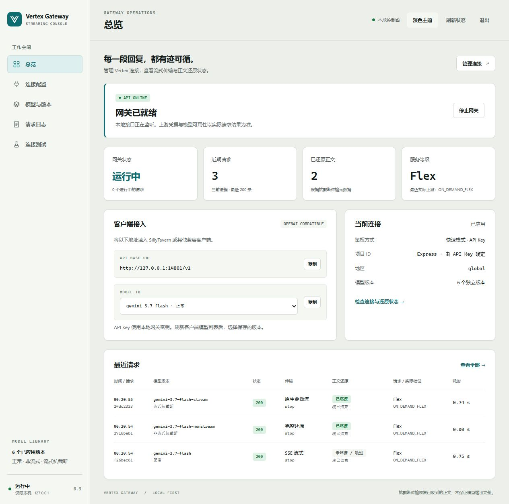
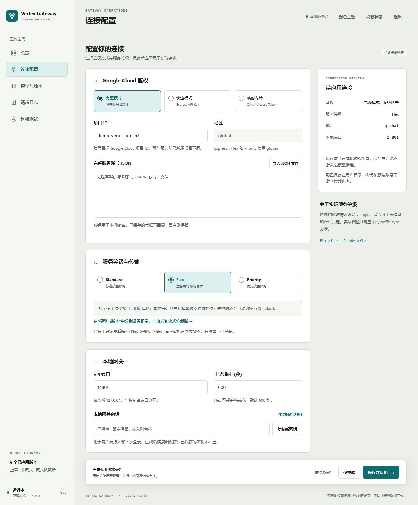
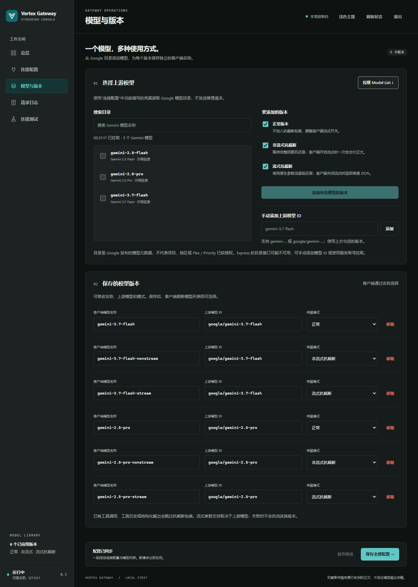
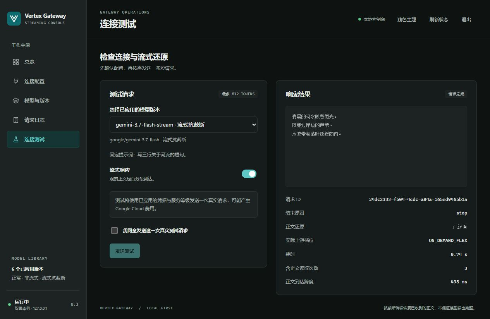

# 独立网关使用手册

中文 | [English](GATEWAY.en.md) · [项目首页](../README.md)

网关为 OpenAI 兼容客户端提供 `/v1/models` 和 `/v1/chat/completions`。每个模型版本单独指定上游模型和传输模式，默认保留 Gemini 3.7 Flash 的入口。

[启动网关](#启动) · [添加模型](#添加多个模型及版本) · [接入中转](#自定义上游) · [标签截停](#自定义标签截停) · [查看请求日志](#查看验收结果)

## 启动

Docker 用户可直接拉取 `ghcr.io/ken050210/vertex-streaming-anti-truncation:latest`。下载 Compose 文件后运行 `docker compose pull`、`docker compose up -d`，再用 `docker compose logs vertex-gateway` 获取首次设置链接。镜像包含控制台与 API，配置保存在数据卷中；详见 [Docker 部署](DOCKER.md)（下载、端口、服务器、反代与容器内酒馆连接）。以下为直接使用 Node.js 的启动方法。

支持完整 Vertex AI 服务账号、Express 快速模式 API Key，以及短期 OAuth access token；也可以改接提供 Gemini 模型的 OpenAI 兼容服务，见[自定义上游](#自定义上游)。完整模式需要已启用 Vertex AI API 的项目和模型调用权限。实际推理按你的 Google Cloud 账户计费。

```sh
git clone https://github.com/ken050210/vertex-streaming-anti-truncation.git
cd vertex-streaming-anti-truncation
npm ci --ignore-scripts
npm start
```

打开终端显示的本地控制台链接，默认地址为 `http://127.0.0.1:4780/`。首次启动会显示带设置密钥的链接；打开它即可进入设置。Windows 也可以双击 `Start-GUI.cmd`，无需预先创建 `.env`。

### 连接与访问密钥

在「连接配置」导入完整服务账号 JSON，也可以选择 Express API Key、短期 OAuth 令牌或[自定义上游](#自定义上游)。控制台会从服务账号填入项目 ID，你可以改成该账号有权访问的其他项目。Express Key、访问令牌和中转密钥只接受可见 ASCII 字符，粘贴时混入中文引号或全角字符会无法保存。

服务等级可选 Standard、Flex 或 Priority。Express、Flex 和 Priority 使用 `global` 地区。Express 填写密钥所属的项目 ID 或项目编号后，请求地址会带上 `projects/{项目}/locations/global`。留空时使用无项目端点，由 Express 选择地区。Gemini 4 Argon 必须填写项目，否则本地会返回 `express_project_required`。

「本地网关」里的访问模式同时控制客户端 API 和控制台登录。

| 访问模式 | 客户端填写什么 |
| --- | --- |
| 强密钥（默认） | 16 到 512 个可见 ASCII 字符，不含空格 |
| 允许弱密钥 | 1 到 512 个可见 ASCII 字符，例如 `123456` |
| 无密钥 | API Key 留空，客户端要求填写时可用占位值 |

新生成的密钥要在保存前复制。保存后凭据不会回显，留空会保留已有值。若曾为其他鉴权方式保存凭据，连接页会显示「保存时删除其他鉴权方式已保存的凭据」。勾选后保存才会删除那些凭据，切换鉴权方式会取消勾选。

切换到弱密钥或无密钥时，须在控制台勾选风险确认。无密钥模式会清除原网关密钥，任何能访问服务的人都可以调用模型、查看日志和修改配置。更换访问模式或网关密钥会让其他已登录会话退出。从无密钥切回时需重新输入密钥。

### 模型、连接测试与配置保存

在「模型与版本」里搜索目录或手动填写上游 ID，再为每个版本选择客户端名称和传输模式，最多可保存 100 个。总览页可以启停网关、复制客户端 URL。最近 200 条请求会显示还原状态、结束原因、请求与实际档位、token 用量及[估算费用](#用量与费用估算)。控制台支持深浅主题和窄屏。

在「连接测试」页选择已保存的模型，勾选并手动运行才会发起推理。测试可选普通或流式响应，输出上限为 512 token，支持取消和查看流式到达时间。启动、保存、校验和拉取模型目录都不会触发推理。

配置和凭据以明文保存在 `~/.vertex-streaming-anti-truncation/settings.json`。需要更换位置时，用 `GATEWAY_STATE_DIR` 指向自己的私密目录。仓库和浏览器存储都不保存凭据。控制台端口默认为 `4780`（`GUI_PORT`），API 端口默认为 `4781`。重启控制台会读取保存的配置并启动网关。

保存时先核对配置版本，再原子替换文件。新请求读取新设置，正在生成的回复沿用旧设置。遇到端口冲突会保留旧监听和配置。更改 API 端口后，客户端在旧端口上保留的连接会收到 `503 gateway_port_changed`，需切换到新端口。

第一次保存前，系统或终端的环境变量优先于 `.env`，后者填空也不会清除同名变量（已在 Node.js 24.16 核对 `--env-file` 行为）。例如设置过 `GOOGLE_APPLICATION_CREDENTIALS` 时，凭据框会显示“已从环境变量导入”。想换账号可以在首次保存前改选鉴权方式，或删除变量后重启。首次保存只写入所选方式的凭据。如果初始配置有误，例如文件不可读或同时设置了多种鉴权方式，控制台会忽略整组环境设置并显示原因。已有 GUI 配置时以保存的值为准。

若进程在恢复过期锁时退出，状态目录可能留下 `settings.lock.recovery`，导致每次保存都提示有其他进程在编辑。先停掉所有配置写入进程，备份 `settings.json`，再核对文件名，仅删除该目录的 `settings.lock.recovery` 后重启。

旧配置里的网关密钥、Express Key 或访问令牌若含非 ASCII 字符，API 启动会失败。可以用原密钥登录控制台，把对应值换成可见 ASCII。仅命令行模式要修改提供该值的 `.env` 或环境变量。

### 仅命令行模式

将 `.env.example` 复制为 `.env`：Windows PowerShell 使用 `Copy-Item .env.example .env`；Linux/macOS 使用 `cp .env.example .env`。然后填写：

- `GATEWAY_KEY_MODE`：默认 `strict`；显式设为 `weak` 表示确认使用简单密钥，设为 `none` 表示确认 API 与控制台均免密。无密钥模式下任何能访问服务的人都能调用模型并管理配置。
- `GATEWAY_API_KEY`：`strict` 模式要求 16–512 个可见 ASCII 字符，不含空格；`weak` 模式接受 1–512 字符（如 `123456`）；`none` 模式忽略此值。
- `VERTEX_PROJECT_ID`：Google Cloud 项目 ID。`VERTEX_LOCATION` 默认 `global`。
- `GOOGLE_APPLICATION_CREDENTIALS`：`.env.example` 中这一行默认被注释。使用服务账号时删掉行首的 `#`，填写仓库之外的服务账号 JSON 路径。Windows 可写成 `C:/keys/service-account.json`。
- 如需用短期 Google OAuth access token，保持上一项注释，改填 `VERTEX_ACCESS_TOKEN`。快速模式改填 `VERTEX_API_KEY`，不要求项目 ID。[自定义上游](#自定义上游)改填 `CUSTOM_UPSTREAM_URL` 和 `CUSTOM_UPSTREAM_API_KEY`，不要求项目 ID。这几种方式只能选一种；一种都没设置时，`npm run gateway` 会提示 `Configure one upstream authentication method: …` 并退出。
- `VERTEX_SERVICE_TIER`：`standard`（默认）、`flex` 或 `priority`。`ANTI_TRUNCATION=false` 可关闭包装。
- `PORT`：默认 `4781`。

系统或终端中已设置的同名变量优先于 `.env`。用以下命令生成随机网关密钥，填入 `.env` 后启动：

```sh
node -e "console.log(require('node:crypto').randomBytes(32).toString('hex'))"
npm run gateway
```

直接运行时服务默认只监听 `127.0.0.1`；Docker 内监听 `0.0.0.0`，默认仅向宿主机本地发布端口。`GET /healthz` 检查进程状态；其余 API 接口在强密钥／弱密钥模式下需要 `Authorization: Bearer <GATEWAY_API_KEY>`，无密钥模式不校验该标头（包括日志接口）。控制台仍保留会话、Host／Origin 和 CSRF 检查；这些检查不替代无密钥模式下已关闭的身份验证。服务账号私钥只在网关进程内签署 JWT，JWT 发给 Google OAuth 换取短期 access token，再用于模型请求。

### 通过代理访问 Google

网关通过 Node 内置的 fetch 访问 Google，默认不使用代理变量。需要代理时：

- 在**启动 Node 之前**，于系统、用户或终端环境中设置 `NODE_USE_ENV_PROXY=1`。把它写进 `.env` 不会生效（已在 Node.js 24.16 上实测）。双击 `Start-GUI.cmd` 启动时，请把它设为 Windows 用户环境变量。
- 设置 `HTTPS_PROXY` 为你的代理地址，并建议设置 `NO_PROXY=127.0.0.1,localhost`，让本机连接（如控制台到本地网关的连接测试）不经过代理。这两项可以放在环境变量或 `.env` 中。
- 需要 Node.js 22.21.0+（22.x）或 24.0.0+。更早的 22.x 会忽略 `NODE_USE_ENV_PROXY`，请求仍直接连接 Google。

```powershell
$env:NODE_USE_ENV_PROXY = "1"; $env:HTTPS_PROXY = "http://127.0.0.1:7890"; $env:NO_PROXY = "127.0.0.1,localhost"; npm start
```

```sh
NODE_USE_ENV_PROXY=1 HTTPS_PROXY=http://127.0.0.1:7890 NO_PROXY=127.0.0.1,localhost npm start
```

把 `http://127.0.0.1:7890` 换成你的代理地址。代理模式下 `UPSTREAM_TIMEOUT_MS` 同样生效；连不上上游时日志记录 `502 upstream_unreachable`。这些设置对[自定义上游](#自定义上游)同样生效；中转服务在局域网里时，要把它的地址加进 `NO_PROXY`，否则请求会绕到代理上。代理路径目前只有本地测试，尚无真实请求验证。

## 添加多个模型及版本

1. 在“连接配置”填写凭据，再进入“模型与版本”点击 **拉取 Model List**。拉取使用当前表单与已保存的凭据，无需先启动网关。
2. 搜索并勾选一个或多个上游模型，选择需要的版本，点击添加。目录不可用时，也可填写 `gemini-…`、`google/gemini-…` 或 `publishers/google/models/gemini-…`。
3. 按需修改客户端模型名称，再点 **保存全部配置**。它会一起保存连接和模型草稿；刷新客户端的模型列表即可选择。

| 版本 | 行为 | 自动生成的名称 |
| --- | --- | --- |
| 正常 | 不加包装，遵循客户端的 `stream` 开关 | `<model>` |
| 非流式抗截断 | 上游完整返回后还原；客户端要求 SSE 时一次性交付正文 | `<model>-antitruncation-nonstream` |
| 流式抗截断 | 客户端开启流式时使用原生参数流；关闭时还原普通 JSON | `<model>-antitruncation-stream` |

三个版本可同时存在，分别通过 `/v1/models` 暴露。名称必须唯一，可以用中文。添加时跳过已有的“上游 + 模式”组合；手动编辑仍可为同一组合保留不同别名。空列表会使客户端没有可选模型。

升级会保留原来的 `gemini-3.7-flash-antitruncation` 名称：原先开启包装时迁移为流式抗截断，关闭时迁移为正常版本。新配置以每个版本的模式为准，不再受旧全局开关影响。

目录来自 Google 的 [Publisher Models 列表接口](https://docs.cloud.google.com/gemini-enterprise-agent-platform/reference/rest/v1beta1/publishers.models/list)，自动分页并筛选 Gemini。它是发布目录，不能证明目标项目、地区、档位或某种模态可以调用。Express 的[公开接口范围](https://docs.cloud.google.com/gemini-enterprise-agent-platform/reference/express-mode/api-reference)未保证模型列表；如果 API Key 被拒绝，页面显示真实 HTTP 状态，可手动添加或改用服务账号拉取。失败不会清空已有模型，也不会用内置目录伪装拉取成功。

## 自定义上游

除了 Google 官方的 Vertex，网关也能接**提供 Gemini 模型的 OpenAI 兼容服务**，例如中转站、new-api / one-api 一类的服务，或 Google AI Studio 的 OpenAI 兼容接口。在“连接配置”选 **自定义上游**，填两项：

- **上游地址（Base URL）**：填到 `/v1` 这一级，例如 `https://relay.example.com/v1`。网关把请求发到“地址/chat/completions”，拉取目录时读“地址/models”。误把完整的 `…/chat/completions` 粘进来也能识别。`http://`（本机或内网服务）和 `https://` 都可以；地址里不能带账号密码、`?` 或 `#`。
- **上游 API Key**：以 `Authorization: Bearer <key>` 发送，只能含可见 ASCII 字符，保存后不回显。

模型照常在“模型与版本”添加。各家中转给模型起名的方式不一样，比如 `gemini-2.5-pro`、`google/gemini-2.5-pro`、`[满血]Gemini-2.5-Pro`，所以接自定义上游时，**上游模型名按页面上写的原样发送**，网关不加也不去前缀：

- 拉取目录读取上游的模型列表，显示名字里带 `gemini`（不分大小写）的模型，名字保持列表里的原样。推荐从这里选，名字一定和上游一致。
- 也可以手动填写，大写、括号、中文、带前缀都行；只要求不为空、不含换行等控制字符、最长 200 个字符。客户端模型名称会自动去掉不允许的字符，例如 `[满血]Gemini-2.5-Pro` 生成 `满血-Gemini-2.5-Pro`，可以再改。
- 保存后，控制台会再读一次上游的模型列表（只读列表，不产生推理费用），把不在列表里的名字列出来提示，能找到相近名字时一并给出，例如“`google/gemini-3.7-flash`（列表里有：`gemini-3.7-flash`）”。只提示、不拦截，因为有的中转列表不全；读不到列表时也会说明没能核对。
- 网关会从名字里认出它指的 Gemini 型号（比如从 `[满血]Gemini-4-Argon` 认出 `gemini-4-argon`），用来决定 Gemini 4 思考等级换算、预填充转 USER 等按型号生效的处理；只影响这些处理，不改发出去的名字。认不出时跳过这些处理，请求照常发送。

从 Vertex 切到自定义上游时，原来的模型名是 `google/gemini-…` 的写法，会原样发出去；如果中转不认，保存后的核对会提示，按提示改名即可。反过来从自定义上游切回 Vertex 时，不符合 Vertex 写法的名字要先改掉才能保存。

和接 Vertex 相比的差别：

| 项目 | 自定义上游 |
| --- | --- |
| 服务等级、地区、项目 ID | 不使用；计费和能用哪些模型由上游决定 |
| 正常版本 | 原样转发 |
| 非流式抗截断 | 可用，前提是上游支持 OpenAI 工具调用并遵守强制调用（`tool_choice`） |
| 流式抗截断 | 可用，但走兼容接口，不是 Vertex 原生参数流。正文能否边写边显示，取决于上游会不会分段转发工具参数；不分段时会等上游写完再一次到达。请求日志的传输方式显示“兼容接口回退（可能等全文）” |
| 思考等级等 Gemini 专用参数 | 照原样放进请求（如 `extra_body.google`），上游是否理会由上游决定 |
| [费用估算](#用量与费用估算) | 不估算；上游报告了用量时，日志只记 token 数 |

上游不支持工具调用时，抗截断起不了作用：上游可能直接报错，也可能忽略工具、照常返回正文（请求日志显示“未还原”）。这种情况请改用正常版本。酒馆插件（Vertex 连接面板）不使用这项设置。

## 多账号轮询（独立网关）

默认关闭。在控制台「连接配置 → 多账号轮询」添加附加账号，再勾选启用并保存。上方原连接作为主账号，最多添加 19 个账号；按请求轮流使用可用账号。Vertex 的服务账号、Express 和 OAuth 可混用；自定义上游只能和其他自定义上游组成池。账号共用模型列表和服务等级，须各自拥有相应模型权限。模型目录发现仍使用主账号。

- 单账号超时：默认 60 秒，可设 1–1800 秒，覆盖鉴权、响应头和整个回复读取。
- 连续失败阈值：默认 2 次，可设 1–100 次。超时、鉴权失败、HTTP 401/403/408/429/5xx、网络及上游协议错误计入失败；成功清零。无效客户端输入、提示词专用重试失败、客户端断连和整次请求总超时不计入。
- 恢复等待时间：默认 60 秒，可设 1–3600 秒。达到阈值的账号被暂时跳过，等待结束后由后续请求重试，无后台推理探测。

达到失败阈值时，若尚未向客户端输出，则当前请求切换到下一可用账号。每次请求每个账号最多尝试一次；未达到阈值则返回本次错误。流式输出已经开始时只记录失败并断开，不重放正文。所有账号均在等待时返回 `503 accounts_unavailable`。单账号超时为 `504 account_timeout`；已有 `UPSTREAM_TIMEOUT_MS` 仍限制整次请求总时长，预算耗尽不再切换。重试可能增加上游用量；提示词重试、long decode 都留在同一账号尝试内。

保存配置或重启会重置轮询顺序、失败次数及等待状态；正在运行的请求保留旧配置。关闭轮询后只使用主账号。附加凭据保存于原配置文件，页面只返回是否已设置；留空保留，输入替换，移除账号并保存会删除该项。日志的 `accountAttempts` 记录每次尝试的账号 ID、状态和耗时，不记录凭据；用量估算仅反映最后一次尝试收到的用量，不包含失败尝试可能产生的费用。

CLI 可在 `.env` 配置 `ACCOUNT_ROTATION_ENABLED=true`、`ACCOUNT_TIMEOUT_MS=60000`、`ACCOUNT_FAILURE_THRESHOLD=2`、`ACCOUNT_COOLDOWN_MS=60000`，并用 `GATEWAY_ACCOUNTS_FILE` 指向仓库外的私密 JSON 数组文件。原有环境变量仍配置主账号。每项包含 `id`（唯一，不能为 `primary`）、`name`、`authMode`、`credential`，以及 Vertex 的 `projectId` / `location`（默认 `global`），或自定义上游的 `customBaseUrl`。服务账号的 `credential` 是完整 JSON 的字符串；其他方式为相应 key / token。不要把此文件提交到仓库。

## 接入 SillyTavern

在“聊天补全 → 自定义（兼容 OpenAI）”连接中设置：

| 设置 | 值 |
| --- | --- |
| API URL | `http://127.0.0.1:4781/v1` |
| API Key | GUI 中设置的本地网关密钥，或 `.env` 中的 `GATEWAY_API_KEY`；无密钥模式可留空，客户端强制要求时填任意占位值 |
| 模型 | 刷新列表后选择保存的版本；默认 `gemini-3.7-flash-antitruncation` |
| 流式传输 | 按需开启；非流式抗截断会等待完整回复 |

如果预设已经有同类工具调用抗截断脚本，只保留一处包装。

网关兼容 `thinking: {type: "disabled"}` 这个 Anthropic 格式字段，但会按 Vertex 兼容接口的原行为忽略它；它不会关闭 Gemini 思考。Gemini 思考设置使用 `extra_body.google.thinking_config`。

## 自定义标签截停

在控制台的「连接配置」里找到「自定义标签截停」。默认规则在本次抗截断回复的第二对完整 `<tucao>…</tucao>` 处结束。把标签名改成 `A`、次数改成 `1`，就会保留第一对 `<A>…</A>`，到 `</A>` 为止。标签之后的所有内容都会被丢弃，包括后面的 MVU 更新块。

网关只数本次正文中完整、无属性、大小写一致的标签对。标签可以跨流式分块，单独的结束标签不计数，同名标签嵌套时只算最外层一对。“继续”从零开始计数，聊天历史、原生思考和客户端工具参数都不参与。普通模型版本和旁路请求照常结束。

上游以流式返回时，网关命中规则就取消读取。上游整段返回时，网关收到回复后再裁剪。本地截停没有最终 token 用量，已经产生的上游费用照常结算。

CLI 使用 `TAG_STOP=true`、`STOP_TAG=tucao`、`STOP_COUNT=2`，关闭时设为 `TAG_STOP=false`。旧开关 `TUCAO_STOP` 仍可使用，升级前已明确关闭的配置会保持关闭。

## 角色扮演兼容设置

在 **连接配置 → SillyTavern 兼容与重试** 中单独控制以下功能。旧配置升级后也使用这些默认值。

| 功能 | 默认 | 行为 |
| --- | --- | --- |
| 隐藏无可用路由的模型 | 开启 | `/v1/models` 隐藏停用版本及已知鉴权失败的连接；临时错误不影响显示 |
| Gemini 3.7 / 3.8 Flash 预填充转 USER | 开启 | 在抗截断包装前，把末尾纯文本 `assistant` 消息改为 `user`，原文不变 |
| 提示词提交失败重试 | 关闭 | 先在 GUI 填入自定义文本，启用后仅对匹配规则（默认一条）的提交错误追加一次请求 |
| Gemini 4 Argon 超长回复自动续写 | 关闭 | 关闭时，超过单次上限（流式 65,536、非流式 32,768 token）的输出额度按单次上限发送，不再报错；开启后回复写满单次上限时用 Google 的 long decode 续写。行为与兼容性风险见 [Gemini 4 输出上限与自动续写](GEMINI4.md#输出上限与自动续写) |

独立网关共用一套上游连接。模型页面的“启用”开关可以停用版本并保留名称和配置；停用版本即使因关闭隐藏而显示，也不能调用。上游返回 HTTP 401 后，该连接的版本会被隐藏。修正凭据后保存应用、重启，或下一次直接调用成功，会清除这项观察。HTTP 403/404/429、超时和 5xx 不用于隐藏模型，也不会主动发起推理探测。目录不能保证 Google 项目拥有某个模型的调用权限。

Google 的 [Gemini 3.7 Flash](https://docs.cloud.google.com/gemini-enterprise-agent-platform/models/guides/gemini-3-7-flash#mandatory-api-rules-and-behavioral-conventions) 和 [3.8 Flash](https://docs.cloud.google.com/gemini-enterprise-agent-platform/models/guides/gemini-3-8-flash#mandatory-api-rules-and-behavioral-conventions) 文档要求对话不能以 `model` 结束，并要求移除预填充。转为 USER 是本项目保留原文的兼容措施，改变了消息角色，不保证模型按原预填充续写。只处理文本字符串或全为文本的内容数组；带工具调用、思考或其他额外元数据的末条消息保持原样。

触发重试的规则可在 GUI 的“触发重试的上游错误（每行一条）”中自定义，留空时只有默认一条 `The prompt could not be submitted`。每条规则是不区分大小写的普通文字，包含即命中；最多 32 条，每条最多 500 字符。只检查上游的拒绝信息：`error.message` / 字符串 `error`（HTTP 非成功响应和 SSE `event: error` 也接受顶层 `message` 或纯文本错误）、OpenAI 兼容接口的拒答 `refusal`（Vertex 兼容接口的流式回复会把“The prompt could not be submitted. The prompt contains sensitive words…”放在 `delta.refusal` 中），以及原生接口的提示词拦截 `promptFeedback.blockReason` / `blockReasonMessage`（Express、Flex 与原生流式走原生接口，需要时可加入 `PROHIBITED_CONTENT` 这类原因码）。检查 HTTP 错误、200 错误对象、拒答及开头的 SSE 错误，初始检查上限 64 KiB；正常回答引用该句不触发，遇到正文、思考或工具输出等有效事件即停止检查。上游错误正文迟迟不结束时，约 5 秒后放弃读取，按已收到的部分判断是否重试，并返回上游状态码。

自定义文本建议自行准备约 7000 tokens；页面计数只是粗估，未调用 Google tokenizer。文本最多 192000 UTF-8 字节，按原样插入到开头连续的 `system` / `developer` 消息之后、其余对话之前，不补齐、不重复、不截断。每个客户端请求最多重试一次，保持同一模型、凭据和服务等级；请求取消、超出大小限制或输出已开始时不会重试。第二次仍失败就结束。此功能可能增加输入费用、上下文占用和等待时间，不保证提交成功。

日志仅增加 `geminiCompatibility.prefillConverted` / `promptRetried` 两个布尔值，GUI 显示转换和重试标记；不记录自定义文本。响应头为 `x-gemini-prefill-converted` / `x-gemini-prompt-retried`。仅命令行模式使用 `HIDE_UNAVAILABLE_MODELS`、`GEMINI_PREFILL_TO_USER`、`GEMINI_LONG_DECODE`、`GEMINI_PROMPT_RETRY_ENABLED`、指向仓库之外 UTF-8 文本文件的 `GEMINI_PROMPT_RETRY_TEXT_FILE`，以及用 `|` 分隔多条规则的 `GEMINI_PROMPT_RETRY_MATCHES`。

## Unicode 输入转码

网关设置中的 **Unicode 输入转码（所有模型）** 是独立总开关，默认关闭；保存并应用后作用于所有模型的后续请求，包括普通、非流式抗截断和流式抗截断。CLI 环境变量为 `UNICODE_INPUT=false|true`。它不改变模型列表或各模型的抗截断模式。编码规则与当前楼层匹配参考灰鸠「GoldRush」（作者网名）的编码器，经作者许可收录，详见 [NOTICE](../NOTICE.zh-CN.md)。

启用时客户端必须提供最新真实用户楼层原文：

```json
{"router_unicode_input":{"user_floor":"最新真实用户楼层原文"}}
```

只对消息文本中的原文、去除首尾空白、归一换行版本做匹配（不依赖 role）。汉字与 ASCII 字母编码为 `⟦U:…⟧`，保留标签、已有编码块、数字、标点和 emoji；不保护 `{{user}}` 内的字母。消息中其他位置的标签和已有编码块内部的匹配内容也不会被替换（这一点有意不同于参考实现）；这里的标签指不跨行、内部不含 `<` 的完整标签（如 `<剧情>`），消息其他位置孤立的 `<`（如 `<3`）不起保护作用。楼层本身编码时，仍与参考实现一样保留所有 `<…>` 片段。三种形式一次扫描，同一位置取较长者，已替换的内容不会再次匹配。未匹配就保持原文，绝不扫描整个 JSON 改写工具名、Schema、模型名或图片地址。工具／Schema 只影响输出抗截断旁路，不关闭输入转码。不追加解码指令。

缺少有效原文返回本地 `400 unicode_floor_required`；编码后超过请求体限制返回 `413 unicode_input_too_large`。本地 `router_unicode_input` 字段在关闭状态下也会被剥离，不转发上游。响应头 `x-unicode-input` 报告 disabled、encoded 或跳过原因；日志仅保存固定状态与计数，不保存楼层原文或编码内容。

酒馆以自定义 API 连接本网关时，可导入并启用 [楼层传递脚本](../integrations/sillytavern-unicode-floor.json)；[可读源码](../integrations/sillytavern-unicode-floor.js) 默认仅匹配 localhost/127.0.0.1/[::1]:4781/v1。更换端口后，在脚本内调整 `gatewayPort`。脚本只提供原文，不决定是否转码；总开关仍在网关。它保留现有 custom body 配置，需要酒馆 `/lib.js` YAML 解析器。停用脚本或刷新即可解除。

使用原生 Vertex 面板插件时，请在插件面板的“输入转码”下拉框中选择 Unicode，无需这个桥接脚本，详见 [插件说明](SILLYTAVERN.md)。两种连接方式分别由各自开关控制；不是跨进程同步设置。关闭预设中的重复转码，以免原文无法匹配。

转码不是加密，不保证模型理解或改善生成结果，可能增加 token 用量和延迟。插件 UI v0.2.0（当时为独立勾选框）已完成配套酒馆安装、开关持久化及三种传输模式的短请求验收；0.3.0 起改用的下拉框在实际酒馆中的导入与持久化尚未验证。这些验收不证明长文本理解或抗截断收益，详见 [验收记录](UNICODE-INPUT-AUDIT.md)。

## 图片输入

控制台提供关闭、当前轮转图、全部会话转图；与 Unicode 输入互斥，默认关闭。CLI 对应 `IMAGE_INPUT=off|current-turn|all`。当前轮以最后一条 assistant 为界；全部会话转换普通 user/assistant 文本。system/developer 指令、工具调用消息、工具结果、原生图片和未知内容部分保留原样。文字被渲染成 1024px 宽的无损 WebP 图片，以图片输入发送。全部会话模式下，开启预填充转 USER 时，Gemini 3.7/3.8 Flash 末尾的文本预填充会先改为 user 再渲染；当前轮模式下，最后一条 AI 消息之后没有可转换的文本时（如点击“继续”或以 AI 消息结尾的预填充），本次按原文发送。

图片渲染参考了 Antigravity experimental 分支的 imagectx（修订 `004067b`）。每页最多 36 行，制表符展开为四个空格，换行统一处理。每个文本片段至少占一页，每次请求限 100 页、150,000 个 UTF-16 单元。因此「全部会话」最多容纳约 100 条含文字的消息，长聊天可以选当前轮。

base64 图片与其余请求内容合计限 8 MiB。若约有 6 MiB 可用于图片，中文约能容纳 2.4 万到 4.5 万字（约 20 到 28 页），带段落的英文约 8 万字符（约 36 页），连续英文最多可到 150,000 个 UTF-16 单元（约 41 页）。实际容量取决于剩余提示词和换行。

| 转换失败的原因 | 返回结果 |
| --- | --- |
| 容量或页数超限 | `413 image_input_too_large` |
| 不支持的 emoji、控制字符或字体缺字 | HTTP 400。字体收录的 ♥ © ™ 等文字样式符号可渲染，ZWSP、ZWNJ、WJ、BOM、VS15 可以保留 |
| 缺少渲染依赖或字体 | `503 image_renderer_unavailable` |
| 渲染或编码失败 | `503 image_render_failed` |

转换失败时请求会停止，模型读图时也可能出现 OCR 错误。

Vertex 原生参数流支持转图后逐段返回正文，自定义上游的交付方式取决于中转。转图可能增加 token 用量和延迟，也不保证减少内容过滤。图片与正文只在内存中处理，日志仅记录模式、状态以及页数、字节数和消息数。[图片输入验收记录（英文）](IMAGE-INPUT-VALIDATION.md)

安装或更新后在项目目录运行 `npm ci --ignore-scripts`。离线部署须包含对应平台的 `@napi-rs/canvas` 二进制和 `assets/fonts` 中随附的 OFL 许可 Noto CJK 字体。只有文字转图时才加载渲染器。

## 流式输出如何工作

Antigravity 网关会逐段解析 SSE。如果兼容接口攒齐工具参数才发送，客户端仍要等到最后。对于可转换的请求，本项目直接读取 Vertex 原生参数流，收到一个片段就解码并交给客户端。

| 项目 | 路径与侧重点 |
| --- | --- |
| Antigravity Gateway | 通用 OpenAI 兼容网关，具备合成工具传输和 SSE 增量解析等功能 |
| 本项目 | 使用原生 `streamGenerateContent`，开启 `streamFunctionCallArguments`，把收到的 `partialArgs` 转成普通 `delta.content` |

测试会让模拟上游停在首段，等客户端收到正文后再允许上游结束，以此检查是否提前交付。真实请求的分段速度仍取决于模型；[Google 将流式函数参数列为 Preview](https://docs.cloud.google.com/vertex-ai/generative-ai/docs/multimodal/function-calling#streaming_function_call_arguments)。

```text
SillyTavern / OpenAI-compatible client
  → local gateway: synthetic text tool
  → Vertex native partialArgs stream
  → incremental JSON decoding
  → ordinary SSE delta.content
```

## 适用范围与限制

流式抗截断版本中，可转换的文本、内嵌 base64 图片、客户端工具和工具历史请求使用原生函数参数分段。Standard 服务账号/OAuth 模式的非流式请求使用 Vertex OpenAI 兼容接口；无法翻译的扩展字段、媒体或额外消息元数据保留原参数并回退到兼容接口，此时可能仍需等待全文。响应头 `x-anti-truncation-transport` 会显示 `tool-transport-buffered-fields`。

接[自定义上游](#自定义上游)时，所有请求都走它的 OpenAI 兼容接口，本节关于原生接口、Express、Flex 和服务等级的说法都不适用；流式抗截断的响应头同样显示 `tool-transport-buffered-fields`。

Express 和 Flex 的普通/流式请求均走原生接口。完整模式（服务账号或访问令牌）下的 Priority 与 Standard 一样走 OpenAI 兼容接口，只有“流式”模式的逐步输出仍走原生流式；Express 下的 Priority 仍走原生接口。以下原生接口限制只适用于走原生接口的请求。支持文本、内嵌 base64 图片、函数工具与工具历史、JSON/Schema、候选数量及常用采样/思考参数。不支持远程图片 URL、旧式 `functions`、`parallel_tool_calls`、logprobs 或未知扩展字段，遇到无法保留的参数返回 `400 unsupported_native_fields`，不会静默丢弃或改走 Standard。客户端工具与抗截断的合成工具一起声明（见下文）；结构化输出仍会跳过抗截断包装，原生接口继续正常翻译请求。

只有请求中所有图片都要求同一级别时，图片的 OpenAI `detail` 才转成 Gemini 整个请求共用的媒体分辨率：`low`/`high` 对应 `MEDIA_RESOLUTION_LOW`/`MEDIA_RESOLUTION_HIGH`。只要有图片是 `auto` 或没写 detail（包括文字转图片生成的页面），或各图片级别不同，就保持默认。`extra_body.google.media_resolution` 优先；只有所有图片一致要求另一个级别时才返回 400。system/developer 消息里的图片返回 400（systemInstruction 只收文字）。只有开头连续的 system/developer 消息进入 systemInstruction；聊天记录之后的（如 Post-History、深度注入）按原位置作为 user 文本发送，与 SillyTavern 自带的 Google 连接一致。

客户端自带工具时照常包装：请求带 `tools` 且 `tool_choice` 省略或为 `auto` 时，合成工具排在客户端工具之后，`tool_choice` 改为 `required`（模型必须调用某个工具），末尾格式说明改为“正文放进合成工具，其他工具按需调用”；客户端的 `parallel_tool_calls` 原样保留。回复里合成工具还原为正文，真实工具调用原样交给客户端，结束原因保持 `tool_calls`；流式中真实调用的 `index` 从 0 连续编号，补上合成调用留下的空位。`tool_choice: "none"` 时客户端工具仍声明但不可调用，照旧强制合成工具。带工具调用历史（`assistant.tool_calls`、`role: tool`）的请求也照常包装，格式说明排在工具结果之后。合成工具固定叫 `router_emit`、描述不变，每次请求的工具声明相同，才能命中 Vertex 隐式缓存；客户端工具名以 `router_emit` 开头时，这一次改用随机名，真实调用照常交回，只是这次命不中缓存。

**多工具参数流（网关 0.16.1 / 插件 0.9.1）**：原生流中的正文逐段还原，客户端工具的参数按调用拼接，完整后连同签名和调用 ID 交付；不会因为声明了客户端工具而等待整条正文。工具历史与内嵌图片可继续走原生流。显式 `parallel_tool_calls` 等无法原生转换的字段仍走兼容回退；自定义上游也仍使用兼容接口。284 项离线测试和 TT 2.4.0 官方 Rust 后端的两轮真实 Gemini 4 Argon 请求通过，含图片、两个测试工具执行与结果回传；WebView 界面和现有角色工作流未验收。

仍跳过包装（`x-anti-truncation-transport` 写明原因）并继续遵循客户端流式开关的请求：`tool_choice` 为 `required` 或指定某个函数（`tool-choice`，客户端要的是工具调用而不是正文）、旧版 `functions`/`function_call`（`existing-tools`/`tool-choice`）、旧版 `role: function` 历史（`tool-history`）、JSON/Schema 输出或多候选。真实工具、usage、思考元数据，以及 `length` / `content_filter` 等结束原因会保留。流中断会报错；网关不自动续写或重试已经开始输出的回复。

原生路线（streaming 模式的原生传输，以及所有 Express 或 Flex 请求）和 buffered 模式转成的 SSE 回复，只有请求设置 `stream_options.include_usage: true` 时网关才发送 choices 为空的用量片段。来自 Vertex OpenAI 兼容接口的流（normal 模式，以及完整模式 Standard／Priority 下回退到该接口的 streaming 模式请求），网关总会向 Vertex 要用量（附带 `stream_options.include_usage`），用于请求日志的[费用估算](#用量与费用估算)；客户端自己设置了 `include_usage` 时照常转发用量片段，没设置时不转发单独的用量片段。自定义上游的流把客户端的 `stream_options` 原样交给上游，用量片段按上游实际返回转发。`router_anti_truncation` 随结束片段发送。

“抗截断”指通过工具参数传输并恢复已收到的文本。它不能恢复模型未生成或网络未收到的内容，也不能保证消除截断或绕过模型限制。

网关不会自动升级、降级或切换所选服务等级。Flex/Priority 发送官方服务等级标头，实际使用的等级以响应中的档位字段（原生接口为 `usage.traffic_type`，兼容接口为 `usage.extra_properties.google.traffic_type`）及日志 `trafficType` 为准；缺失时显示“上游未报告”。模型、账户及 Express 对档位的实际支持须由真实请求验证。参见 [Express 端点](https://docs.cloud.google.com/gemini-enterprise-agent-platform/models/start/express-mode/overview)、[Flex](https://docs.cloud.google.com/gemini-enterprise-agent-platform/models/flex-paygo) 和 [Priority](https://docs.cloud.google.com/gemini-enterprise-agent-platform/models/priority-paygo) 官方说明。独立网关的[多账号轮询](#多账号轮询独立网关)默认关闭，账号额度由上游管理。

### 模型不支持的参数与上游超时

发往以下上游模型的请求，会在发送前去掉 Google 文档明确写明不支持的字段，不需要先失败一次。响应头 `x-gemini-dropped-params` 和日志 `droppedParams` 列出实际去掉的字段名，不记录取值。

| 上游模型 | 去掉的字段 | 文档依据 |
| --- | --- | --- |
| gemini-3.8-flash、gemini-3.7-flash | frequency_penalty、presence_penalty、n（即 candidate_count）、temperature、top_p、top_k | [3.7](https://docs.cloud.google.com/gemini-enterprise-agent-platform/models/guides/gemini-3-7-flash) / [3.8](https://docs.cloud.google.com/gemini-enterprise-agent-platform/models/guides/gemini-3-8-flash) 开发指南：“Remove the following unsupported parameters: frequency_penalty, presence_penalty, candidate_count, temperature, top_p, and top_k.” |
| gemini-3.6-flash、gemini-3.5-flash-lite | frequency_penalty、presence_penalty、temperature、top_p、top_k | 模型页：“Custom values for parameters like temperature, top-K, and top-P aren't supported.” 以及惩罚参数 “aren't supported” |
| gemini-3.5-flash | frequency_penalty、presence_penalty、top_k | 开发指南：惩罚参数会导致 “runtime errors”；模型页：topK “64 (fixed)” |
| gemini-3-flash-preview、gemini-3.1-pro-preview、gemini-3.1-flash-lite、gemini-2.5-pro | top_k | 模型页：topK “64 (fixed)” |
| 任意模型 | 同时提供 `reasoning_effort` 与 `extra_body.google.thinking_config` 时去掉 `reasoning_effort` | [OpenAI 兼容概览](https://docs.cloud.google.com/gemini-enterprise-agent-platform/models/migrate/openai/overview)：“only one of reasoning_effort or extra_body.google.thinking_config may be specified” |

依据为 2026-09-24 更新的官方页面（2026-09-25 核对）。模型 ID 带 `@版本` 时按基础模型处理；未列出的模型保持原样。模型页仍给出可用范围的 temperature/top_p（例如 3.5 Flash）不会去掉。

`UPSTREAM_TIMEOUT_MS`（默认 600000 毫秒）现在同时限制等待上游响应头和正文分段的时间。此前 Node 内置 fetch 自带 300 秒上限，非流式长回复等满 300 秒就以 `Headers Timeout Error` 失败，与设置无关。它同时是单个请求的总时长上限，从网关收到请求时开始计算：到时即使上游仍在输出也会中止，已经开始的流式回复会被切断，日志记录为 `504 upstream_timeout`。很长的回复或 Flex 请在 GUI 中调高上游超时，最多 1800 秒。

## 响应与 Schema 校验

所有模式均检查普通回复和 SSE 的有效输出、结束原因与 DONE。空回复、只思考却声称正常完成、错误事件、半截流和不完整工具参数会失败；长度上限、内容拦截与客户端取消分别记录。`responseIntegrity` 日志仅含固定状态，不含回复内容。原生接口的回复还会在 `nativeFinishReason` 中记录 Google 原始结束代码（如 `STOP`、`MALFORMED_FUNCTION_CALL`），只接受大写枚举形式；兼容接口为 `null`。

非流式异常区分 `invalid_choice`（候选项不是对象）、`missing_message`（消息缺失或为空）、`invalid_message`（消息类型错误）和 `unexpected_stream_chunk`（收到仅含 delta 的流式片段）。校验失败时仍保留已知结束原因与空回复状态，客户端错误中的 `responseIntegrity`、日志和 GUI 使用同一份固定字段。缺失消息仍是失败，不补造正文，也不会因此触发自定义文本重试；旧日志缺失的信息无法追补。

原生结构化输出通过 `responseJsonSchema`、工具参数通过 `parametersJsonSchema` 保留约束；不会删除 `additionalProperties`，不会误删同名业务属性，也不会缩窄无 items 数组。支持范围内的 `strict: true` 输出在完成时接受本地 Schema 校验。`oneOf`（上游语义与 JSON Schema 不同）、`pattern` 等不支持的约束在鉴权/推理前返回 `400 unsupported_native_schema` 和参数路径；路径指明是第几个工具（如 `/tools/1/function/parameters/...`），未解析的 `$ref` 指向它所在的节点；结构化输出的路径以 `/response_format/json_schema/schema` 开头，直接发送不带 `{name, schema}` 包装的 Schema 时以 `/response_format/json_schema` 开头。

普通文字持续流式传递；仅显式结构化 JSON 与工具参数为校验使用有大小上限的临时缓冲。结构化流的最终校验失败会中断响应，不会自动补 JSON、续写或重试。Standard 兼容接口仍按原请求转发，其 Schema 约束由上游处理。

## 查看验收结果

JSON 日志记录请求 ID、状态、耗时和 `antiTruncation` 元数据，不记录提示词、回复正文、工具参数或密钥。`GET /admin/events` 返回进程内最近 200 条记录，重启后清空。需要持久日志时，将标准输出重定向到仓库之外。

### 用量与费用估算

上游报告了用量时，每条记录带 `usage`（`promptTokens` 输入、`cachedTokens` 其中命中缓存的部分、`outputTokens` 输出，含思考）和 `estimatedCostUsd`（美元），请求日志的“用量 / 估算费用”一列显示同样的数字。为了拿到用量，网关在请求 Vertex 兼容接口的流式回复时会附带 `stream_options.include_usage`；客户端自己没要用量时，这一段不会转发给客户端。

估算用的是网关内置的 Google 官方价目（[Vertex 生成式 AI 价目](https://cloud.google.com/vertex-ai/generative-ai/pricing)，2026-10-17 核对），按以下规则计算：

- 按请求日期选价：Gemini 3.6/3.7/3.8 Flash 的推广价到 2026-12-31，Gemini 4 Argon 到 2026-11-30，之后自动换成原价。推广价是 Google 以 50% 返还抵扣后的实付价。
- 档位按上游实际报告的 `trafficType` 计：Priority 为 Standard 的 1.8 倍，Flex 为 0.5 倍；没报告时按所选档位计。预配吞吐量（Provisioned Throughput）不估算。
- 非 global 地区的 Gemini 3 及更新模型加 10%；输入超过 20 万 token 时，2.5 Pro 和 3.1 Pro Preview 整个请求按长上下文价计。
- 不估算：自定义上游（中转按自己的规则收费）、价目表没收录的模型（如 Gemini 3 Flash Preview，官方页面未列出其输出价）、上游没报告用量的请求（如中途失败或取消）。
- 只计这次交回的上游回复的 token，不含缓存存储、联网搜索等其他费用；提示词重试时，被拒的第一次提交不计入。

这是估算，以 Google Cloud 账单为准。Google 调价后需要更新 `src/pricing.mjs` 里的价目表。

### 请求错误

`/v1/chat/completions` 失败时会返回 `error` 对象，其中有 `code`、`message`、`type` 和 `requestId`。可以用请求 ID 对照日志。

| 错误码 | HTTP 状态 | 原因 |
| --- | --- | --- |
| `credential_error` | 502 | 换取访问令牌失败，或密钥、令牌含无法放进请求头的字符 |
| `upstream_unreachable` | 502 | 连不上上游，检查地址、网络、DNS、TLS 或代理 |
| `upstream_http_error` | 上游返回的状态 | 网关保留上游状态和 `Retry-After` |
| `upstream_timeout` | 504 | 请求超时 |
| `request_too_large` | 413 | 请求体超过 8 MiB。若文件未传完就超时，返回 504 |
| `image_render_failed` | 503 | 本地图片渲染失败 |
| `upstream_protocol_error` | 502 | 上游回复格式异常或中途断开 |

上游 HTTP 错误和输出前的流式错误（`upstream_stream_error`、`native_stream_error`）还会带 `upstreamError`。其中最多保留 240 个字符的 `message`，会去除标记、邮箱、密钥类字符串、长令牌和本次凭据。Google 格式的错误还可能带 `status` 和 ErrorInfo 的 `reason`。日志只保留状态和原因。

### 核对流式回复

原生流式抗截断正常结束时，成功的请求记录会包含以下字段。

```json
{
  "antiTruncation": {
    "transport": "tool-transport-native-streaming",
    "restored": true,
    "finishReason": "stop",
    "streamDone": true
  }
}
```

`restored: false` 表示未还原或跳过，`null` 表示尚未确认。`restored: true` 加 `length` 仍表示输出达到长度限制。这些标志能确认传输还原和结束状态，不能证明同一回复在不用网关时一定会截断。控制台连接测试结果中的“传输方式”一行与日志的 `antiTruncation.transport` 相同；请求日志还会显示 Unicode 输入转码和图片输入的结果。

```sh
npm run verify
# 可选：发送两条短请求，每次最多 512 输出 tokens；开启重试时最多 4 次上游提交
npm run smoke -- --live
```

烟测检查的是 Vertex 原生参数流，只适用于 Vertex 连接；接自定义上游时会直接停下并说明原因，请改用控制台的连接测试。烟测默认使用已保存的 GUI 配置，没有保存配置时使用环境变量；仅命令行服务可加 `--env` 强制使用 `.env`。默认测试第一个流式抗截断版本，也可加 `--model 你的模型名称` 指定；正常和非流式版本可在 GUI 测试页验证。此命令只测纯文本输入，开启图片输入时会在发送前停止。运行此项烟测时请先关闭图片输入。

默认测试使用本地模拟数据，不需要真实凭据，也不产生推理费用。烟测会统计正文到达次数和时间跨度，并用响应请求 ID 核对日志。验证范围见 [docs/VALIDATION.md](VALIDATION.md)。

## 控制台预览

截图来自 0.7.0 控制台，使用演示配置、模拟上游和演示端口，分别展示深浅主题。实际默认端口为控制台 `4780`、API `4781`。

总览页显示网关状态、客户端地址、模型版本和最近请求。



<details>
<summary>连接配置：项目 ID、服务账号 / Express API Key、Standard / Flex / Priority</summary>



</details>

<details>
<summary>模型与版本：拉取目录，同一模型保存正常、非流式抗截断和流式抗截断版本</summary>



</details>

<details>
<summary>连接测试：流式正文、还原状态与正文到达统计</summary>



</details>
